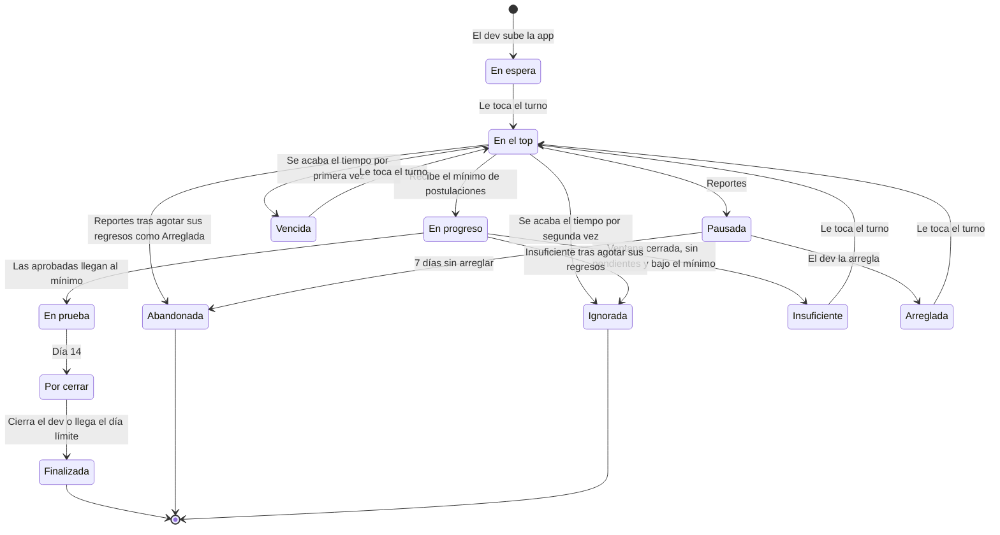

# PRD — Cola de testers para Google Play

Nov 1, 2026 · @Carlos

## Resumen y problema

Una plataforma comunitaria donde las apps que deben pasar la prueba cerrada de Google Play avanzan en una cola: solo 5 apps se pueden probar a la vez, y cada una cede su lugar al conseguir el mínimo de postulantes de su plan: 12 en el gratuito, 15 en el de pago.

### Problema

Google exige a las cuentas personales de desarrollador nuevas un test cerrado con al menos 12 testers inscritos durante los últimos 14 días continuos antes de solicitar acceso a producción ([Ayuda de Play Console](https://support.google.com/googleplay/android-developer/answer/14151465)).

Las comunidades actuales de intercambio de testers funcionan como un feed. Con la llegada masiva de apps hechas con IA, una app publicada queda perdida en pocas horas: hay muchas apps, la mayoría con pocos testers, y completar la prueba cerrada se vuelve difícil.

### Propuesta de valor

- **Atención concentrada:** el top limita cuántas apps compiten por testers al mismo tiempo.
- **Turno visible:** cada dev ve su posición y recibe avisos a medida que se acerca.
- **Compromisos verificables:** capturas de instalación y de permanencia, rechazos públicos y una calificación visible para todos.
- **Gratis para empezar:** la primera app entra sin requisitos.

La plataforma consigue testers reales y comprometidos. No garantiza el acceso a producción: esa decisión es de Google.

## Regla base: la cadena de responsabilidad

Toda función, gratuita o de pago, actual o futura, debe respetar la cadena de responsabilidad: nadie sube su siguiente app sin haber cumplido los compromisos de la anterior que afectan a otros. Lo que perjudica a otros bloquea; lo que solo perjudica a quien no cumple se resuelve solo y queda visible en su calificación.

La primera app no exige nada. Desde la segunda, para subir la siguiente app el usuario necesita:

1. Que su app anterior ya no esté activa: Finalizada, Abandonada o Ignorada.
2. Al menos una instalación aprobada en la app de otro desde que subió su app anterior.
3. Que su última permanencia no haya sido rechazada ni haya quedado sin entregar.

Un compromiso que todavía no vence no bloquea: una permanencia pendiente no impide subir la siguiente app. Los compromisos como dev (validar y cerrar) tampoco bloquean: se resuelven solos al vencer, con la aprobación automática y el cierre de la plataforma, y bajan la calificación, que es visible para todos.

Es la regla sobre la que se sostiene la plataforma. Si una función permite saltarse una condición de la regla base, o evitar un compromiso sin que baje la calificación, se rediseña o no se incluye.

> Para quien construya la plataforma, sean personas o agentes de IA: antes de agregar o cambiar una función, verificar que respete esta regla. Si no la respeta, no se implementa.

### Cómo evaluar una función nueva

1. ¿Permite subir una app sin cumplir las condiciones de la regla base? Entonces no se incluye.
2. ¿Permite evitar un compromiso (entregar una captura, validar, cerrar) sin que afecte la calificación? Entonces no se incluye.
3. ¿Cambia cuánto o cómo se cumple, sin quitar ninguna obligación? Entonces se puede incluir.

### Funciones de pago evaluadas

| Función | ¿Respeta la cadena? | Por qué |
| --- | --- | --- |
| Apps adicionales, desde la tercera, con más postulantes (mínimo 15, hasta 20) | Sí | Cada app sigue requiriendo los compromisos de la anterior; el margen exige más testers y más validaciones al dev |

## Objetivos y alcance del MVP

El MVP busca que cada app consiga los testers comprometidos de su plan sin que la cola se detenga.

### Objetivos

- Que cada app que llega al top consiga el mínimo de postulantes de su plan.
- Que la cola avance: ninguna app ocupa el top indefinidamente.
- Que devs y postulantes cumplan sus compromisos, incentivados por la calificación y la cadena de desbloqueo.
- Reunir datos sobre cómo terminó cada prueba cerrada.

### Señales para ajustar la cola

| Señal | Qué indica | Ajuste |
| --- | --- | --- |
| La cola crece semana a semana | Entran más apps de las que salen | Subir las instalaciones requeridas para llegar al top |
| Las apps del top se llenan en minutos y los testers no encuentran dónde postularse | Hay más testers que apps disponibles | Ampliar el top |
| Los testers prefieren unirse a apps En progreso y las del top tardan más en llenarse | La ventana para postulantes adicionales le quita testers al top | Reducir la ventana para postulantes adicionales |

### Incluido en el MVP

- Cola con top, estados, tiempos límite y reportes de apps que no abren.
- Postulaciones con capturas de instalación y de permanencia, validadas por el dev con aprobación automática.
- Cadena de desbloqueo por compromisos y calificación visible.
- Rechazos y reportes públicos, sin sus capturas.
- Plan gratuito y pago por uso.
- Notificaciones por email y web push en cada etapa.
- Parámetros configurables.
- Panel de administración (por definir; ver Pendientes).

### Fuera del alcance

- Garantizar el acceso a producción en Google Play.
- Validar automáticamente capturas, disponibilidad por país o apelaciones.
- Arquitectura técnica: se define en otra sesión.
- Baja de usuarios.
- Funciones posteriores al MVP, listadas en Pendientes.

## Terminología y principios

La plataforma no usa la palabra "aplicación": el software es una **app** y la acción del tester es una **postulación**.

### Terminología

| Término | Significado |
| --- | --- |
| App | El software que se sube para conseguir testers |
| Usuario | Una sola cuenta que actúa en dos roles: dev y postulante |
| Dev | El usuario cuando sube su app |
| Postulante | El usuario cuando se postula a la app de otro |
| Postulación | La acción de postularse; siempre incluye la captura de instalación |
| Captura de instalación | Prueba de que el postulante instaló la app (día 1) |
| Captura de permanencia | Prueba de que el postulante siguió en el test (día 14) |
| Validación | El dev aprueba o rechaza una captura; sin respuesta en plazo, se aprueba sola |
| Estado de una captura | Pendiente (por defecto), aprobada o rechazada; aplica a las capturas de instalación y de permanencia |
| Compromiso | Una obligación con plazo: instalar, permanecer, validar o cerrar |
| Cierre | El dev valida las permanencias e informa cómo le fue en Google Play |
| Top | Las apps activas que pueden recibir postulaciones |
| Reencolada | Una app que vuelve a la cola: Insuficiente, Arreglada o Vencida |
| Package name | El identificador de la app en Google Play, extraído de su link |

### Principios: confianza y contención

La plataforma equilibra dos sistemas para que la cola avance. **Confianza** es lo que queda a criterio de los usuarios. **Contención** es lo que la plataforma exige o restringe.

| Confianza | Contención |
| --- | --- |
| La primera app entra sin requisitos | Compromisos como postulante para desbloquear la siguiente app |
| El dev valida las capturas | Aprobación automática al vencer el plazo |
| El postulante elige a qué apps postularse | Instalaciones requeridas para llegar al top |
| El dev declara que su app está disponible en todos los países | Tiempo límite en el top |
| El dev confirma que está en el grupo de Google y que su test cerrado lo usa | Rechazos y reportes públicos |
| El dev indica que arregló una app pausada | Pausa automática por reportes |
| El dev informa su resultado en Google Play | Cierre automático al día límite |
| Cada usuario decide si confía en otro según su calificación | Detección de capturas duplicadas |
| Una instalación aprobada desbloquea la siguiente app sin esperar la permanencia | Bloqueo por permanencia fallida |

## Flujo y estados de una app

Una app avanza en línea recta de la cola al cierre, salvo cuando vence su tiempo en el top, queda Insuficiente o recibe suficientes reportes. En esos casos vuelve a la cola como reencolada, con un límite de veces, o termina Ignorada o Abandonada (ver Reencolamiento).

| Estado | Qué pasa |
| --- | --- |
| En espera | Aguarda su turno; aparece en la cola si está entre las 20 próximas |
| En el top | Recibe postulaciones durante su tiempo límite y puede ser reportada |
| En progreso | Recibió el mínimo de capturas de su plan (12 o 15). Dura como máximo 24 h: el dev valida las capturas y, durante las primeras 12 h, acepta postulantes adicionales hasta el máximo (15 o 20) |
| Insuficiente | Terminó la ventana de postulantes adicionales, no quedan capturas pendientes y las aprobadas no llegan al mínimo; vuelve a la cola conservando sus aprobadas |
| Vencida | Se le acabó el tiempo en el top antes de recibir el mínimo de postulaciones; vuelve a la cola con sus postulantes |
| Arreglada | El dev indicó que arregló su app pausada; vuelve a la cola con sus postulantes |
| En prueba | Las capturas aprobadas llegaron al mínimo; nadie más puede unirse y corren los 14 días |
| Por cerrar | Desde el día 14: el dev valida las permanencias y cierra |
| Finalizada | La cerró el dev o la plataforma al día límite; el dev queda libre para su siguiente app |
| Pausada | Recibió suficientes reportes mientras estaba en el top; espera que el dev la arregle, como máximo 7 días |
| Abandonada | No se arregló a tiempo, o se pausó otra vez después de agotar sus regresos como Arreglada; el dev pierde el desbloqueo usado, la app cuenta dentro de su total de apps y su calificación baja |
| Ignorada | Se le acabó el tiempo en el top por segunda vez, o quedó Insuficiente otra vez después de agotar sus regresos; el dev queda libre para su siguiente app, la app cuenta dentro de su total de apps y su calificación no baja |

### Diagrama de estados

### Cola visible y estados internos

La cola se muestra en tres partes, y cada una agrupa uno o más estados internos.

| Parte en la UI | Estados que incluye |
| --- | --- |
| Top | En el top |
| In progress | En progreso, solo durante su ventana de 12 h para postulantes adicionales |
| Waiting | En espera, Insuficiente, Arreglada y Vencida |

- Waiting muestra sus estados juntos, sin diferencia visual entre apps nuevas y reencoladas. Solo cambia el orden: primero las Insuficiente, luego las Arreglada y al final las nuevas y las Vencida, mezcladas.
- Dentro de cada grupo, las apps se ordenan por fecha de entrada a la cola: la de subida para una app nueva y la de regreso para una reencolada.
- Una app En progreso deja de mostrarse al cerrarse su ventana de 12 h, aunque el dev siga validando.
- Las apps En prueba, Por cerrar, Pausada, Finalizada, Abandonada e Ignorada no se muestran en la cola; el dev y sus postulantes las siguen viendo en sus apps y en sus pruebas.

### Historial de estados

Cada app guarda el historial de sus transiciones: estado de origen, estado de destino, fecha y hora, y causa (acción del dev, vencimiento de un plazo, reportes o aprobación automática).

- Lo ven el dev de la app y el panel de administración; no es público.
- De él salen los conteos de reencolamientos y vencimientos, los datos sobre cómo terminó cada prueba y la evidencia para decidir reembolsos.

## Reglas de operación

Cada dev tiene una sola app activa a la vez, que avanza según su turno en la cola y sale del top al conseguir el mínimo de postulantes de su plan: 12 en el gratuito, 15 en el de pago.

### Subida de una app

- El dev pega el link de Google Play de su test cerrado; la plataforma extrae el package name.
- Cada package name pertenece a una sola cuenta: la primera que lo registra.
- El dev marca una casilla confirmando que la app está disponible en todos los países.
- El test cerrado usa el grupo de Google de la plataforma. Los grupos propios del dev quedan como función activable.
- Cada usuario se une al grupo de Google por su cuenta. Al subir su primera app, el dev confirma con una casilla que ya está en el grupo. En cada app que sube, confirma con otra casilla que su test cerrado usa el grupo de la plataforma. Ninguna de las dos se verifica.
- Una vez subida, el dev no puede retirar la app ni cambiar su link de Google Play. Un link incorrecto es responsabilidad del dev.
- La primera app entra sin requisitos. Las siguientes dependen de la cadena de desbloqueo (ver Compromisos).
- Una app activa a la vez por dev, en plan gratuito y de pago. Una app deja de estar activa al llegar a Finalizada, Abandonada o Ignorada.
- La pantalla de subida muestra el aviso de que la plataforma no garantiza el acceso a producción.

### Cola y top

- La cola se ordena por grupos y, dentro de cada grupo, por fecha de entrada (ver Cola visible y estados internos). Se muestran las 20 próximas apps y la calificación de cada dev.
- Hay 5 apps en el top. Para entrar, la app necesita su turno y que el dev tenga las instalaciones aprobadas requeridas, contadas desde que subió su app anterior (0 en el lanzamiento). Las instalaciones solo se exigen la primera vez que la app entra al top.
- Tiempo en el top: 72 h en el lanzamiento, luego 24 h. Si se acaba antes de recibir el mínimo de postulaciones, la app pasa a Vencida y vuelve a la cola; si le pasa por segunda vez, pasa a Ignorada (ver Reencolamiento).
- Cada app tiene su propio tiempo límite: se calcula al entrar al top, con el valor vigente del parámetro que le corresponde (el normal o el de su tipo de reencolada). Si un parámetro cambia, solo afecta a las apps que entren al top después; las que ya están conservan su tiempo límite.
- Al recibir el mínimo de postulaciones de su plan (12 gratis, 15 de pago), la app pasa a En progreso y libera su lugar.
- En progreso dura como máximo 24 h. Durante sus primeras 12 h acepta postulantes adicionales hasta el máximo de su plan (15 gratis, 20 de pago); las capturas de los adicionales también cuentan para completar el mínimo.
- En cuanto las capturas aprobadas llegan al mínimo, por el dev o por aprobación automática, la app pasa a En prueba y deja de mostrarse en la cola, aunque no hayan pasado las 12 h.
- Si termina la ventana de postulantes adicionales, no quedan capturas pendientes y las aprobadas no llegan al mínimo, la app pasa a Insuficiente y vuelve a la cola (ver Reencolamiento). Mientras quede una captura pendiente o la ventana siga abierta, la app sigue En progreso.

| Caso (plan gratis: mínimo 12) | Resultado |
| --- | --- |
| El dev aprueba 12 en la hora 3 | Pasa a En prueba en la hora 3 |
| Rechaza 1 en la hora 5 y no llega ningún adicional | Espera al cierre de la ventana, en la hora 12, y pasa a Insuficiente |
| Rechaza 1 en la hora 5; llega un adicional en la hora 8 y el dev no lo revisa | Se aprueba solo en la hora 24 y pasa a En prueba |
| Rechaza a ese adicional en la hora 13 | Sin pendientes, ventana cerrada y 11 aprobadas: pasa a Insuficiente |
| El dev no revisa nada | Todo se aprueba solo en la hora 24 y pasa a En prueba |

### Reencolamiento

Una app reencolada vuelve a Waiting, conserva lo que ya consiguió y, al volver al top, solo necesita lo que le falta.

| Reencolada | Qué conserva | Tiempo en el top al volver | Límite |
| --- | --- | --- | --- |
| Insuficiente | Sus capturas aprobadas; las rechazadas no cuentan | 6 h | 2 regresos; si queda Insuficiente una tercera vez, pasa a Ignorada |
| Arreglada | Todos sus postulantes | El normal | 2 regresos; si se pausa una tercera vez, pasa a Abandonada sin esperar los 7 días |
| Vencida | Todos sus postulantes, incluidas las capturas pendientes, que se siguen aprobando solas | 12 h | 1 regreso; el segundo vencimiento la deja Ignorada |

- Los vencimientos se cuentan por app, sin importar de dónde venga: la primera vez que se le acaba el tiempo en el top, sea nueva o reencolada, pasa a Vencida; la segunda, a Ignorada.
- Cada tipo de reencolada tiene su propio contador de regresos.
- Al volver a llegar a su mínimo, la reencolada pasa otra vez por En progreso con las mismas reglas: 24 h en total y 12 h para postulantes adicionales.
- Una app Arreglada vuelve con el conteo de reportes para pausar en cero. Los reportes anteriores siguen siendo públicos y quedan en su historial.
- Los tiempos y los límites de Insuficiente y Arreglada son parámetros (ver Parámetros configurables). El regreso único de Vencida es fijo.

### Postulaciones y capturas

- Postularse es enviar la captura de instalación. No hay límite de postulaciones simultáneas.
- La instalación cuenta para el postulante al enviarla; si el dev la rechaza, se descuenta. Una captura rechazada no se puede reenviar: el rechazo es definitivo y no se puede apelar.
- Toda captura, de instalación o de permanencia, empieza como pendiente y pasa a aprobada o rechazada.
- El dev valida todas las postulaciones que recibe, hasta el máximo de su plan. Tiene 24 h por captura y recibe un recordatorio 6 h antes de que se aprueben solas. En En progreso el límite es único: todas las capturas pendientes se aprueban solas como tarde a las 24 h de que la app entró en ese estado, incluidas las de los postulantes adicionales. La demora del dev nunca castiga al postulante.
- Un rechazo requiere una justificación escrita de 30 a 280 caracteres y se basa en la captura, nunca en la calificación del postulante.
- La plataforma bloquea capturas duplicadas o casi idénticas antes de que lleguen al dev.
- Los 14 días empiezan cuando las capturas aprobadas llegan al mínimo de su plan (12 o 15) y la app pasa a En prueba. La plataforma muestra al dev dos fechas: desde cuándo puede solicitar producción a Google y su fecha límite de cierre.
- Los postulantes adicionales se unen antes de que empiecen los 14 días, así que el día 14 y el día límite son los mismos para todos los postulantes de la app.
- La captura de permanencia se envía el día 14, con 2 días de margen.
- El dev valida las capturas de permanencia igual que las de instalación: tiene 24 h para aprobarlas o rechazarlas con una justificación escrita; sin respuesta, se aprueban solas. El rechazo no se puede apelar, baja la calificación del postulante y bloquea su siguiente app hasta que cumpla una permanencia en otra app.

### Cierre

- Antes del día límite (día 20), el dev valida las permanencias y sube una captura de Play Console que muestra si se cumplió el requisito del test cerrado. Esa captura es informativa: no comprueba ni bloquea nada.
- Si el dev no cierra a tiempo, la plataforma cierra la app y su calificación baja.
- El resultado final de producción (aprobada o rechazada, y si el rechazo tuvo que ver con los testers) es opcional e informativo.

### Reportes de "no abre" o "no disponible"

- Cualquier usuario puede reportar una app, pero solo mientras está en el top. Cada reporte lleva captura, un motivo (no abre, no disponible en mi país, pide login o se cierra) y una justificación escrita de 30 a 280 caracteres.
- La app se pausa cuando recibe **al menos 3 reportes de cuentas distintas** y esos reportes son **más del 50%** de los usuarios que interactuaron con ella (postulaciones más reportes).

| Reportes | Postulaciones | % de reportes | ¿Se pausa? |
| --- | --- | --- | --- |
| 2 | 0 | 100% | No: no llega al mínimo de 3 |
| 3 | 2 | 60% | Sí |
| 3 | 12 | 20% | No: funciona para casi todos |
| 6 | 5 | 55% | Sí |

- Cuando el dev indica que la arregló, la app pasa a Arreglada y vuelve a la cola con sus postulantes, sin verificación automática (ver Reencolamiento).
- Si no la arregla en 7 días, o si se pausa otra vez después de agotar sus regresos como Arreglada, pasa a Abandonada: el dev pierde el desbloqueo usado y su calificación baja.
- Los reportes no se pueden apelar en el MVP.

### Transparencia de rechazos y reportes

Los rechazos y los reportes son públicos, para que cada usuario pueda juzgar a los demás por lo que hacen. Se muestra todo lo que no comprometa a nadie: nunca las capturas.

- Todos los que participan en la prueba de una app ven los rechazos del dev: a qué postulante, el tipo de captura, el motivo y la justificación.
- Los reportes de una app son públicos: quién reportó, el motivo y la justificación.
- El perfil de cada usuario muestra los rechazos que hizo como dev y los que recibió como postulante.

## Compromisos, desbloqueo y calificación

Cumplir los compromisos como postulante desbloquea la siguiente app. Todos los compromisos, como dev y como postulante, definen la calificación visible de cada usuario.

### Compromisos

| Rol | Compromiso | Plazo | Si no cumple |
| --- | --- | --- | --- |
| Postulante | Postularse: una captura de instalación aprobada en la app de otro | Desde que subió su app anterior, antes de subir la siguiente | Bloquea su siguiente app |
| Postulante | Captura de permanencia | Día 14, con 2 días de margen | Si no la entrega o se la rechazan, baja su calificación y bloquea su siguiente app hasta que cumpla una permanencia en otra app |
| Dev | Validar las capturas recibidas (instalación y permanencia) | 24 h por captura; en En progreso, como tarde 24 h desde que la app entró en ese estado | Se aprueban solas y baja su calificación |
| Dev | Cerrar la app | Día 20 | La plataforma la cierra y baja su calificación |

### Cadena de desbloqueo

- La primera app no requiere compromisos previos. Así se alimenta la plataforma.
- Desde la segunda, el usuario sube su siguiente app al cumplir las tres condiciones de la regla base.
- Postularse es obligatorio: el compromiso se cumple con la primera instalación aprobada en la app de otro desde que el usuario subió su app anterior.
- La instalación aprobada desbloquea la siguiente app sin esperar los 14 días. La permanencia de esa postulación queda pendiente y no bloquea mientras no venza, aunque venza después de que la app del usuario se finalice.
- Si una permanencia se rechaza o no se entrega a tiempo, el usuario no puede subir otra app hasta postularse a otra app y que le aprueben esa permanencia.
- La cadena aplica igual en el plan de pago: pagar quita el límite de cantidad, no los compromisos.
- Si una app termina Abandonada, el desbloqueo usado para subirla se pierde y la app cuenta igual dentro del total de apps del dev, incluidas las 2 gratuitas.
- Si una app termina Ignorada, el dev queda libre para su siguiente app y su calificación no baja: la falta de interés no es un compromiso incumplido. La app cuenta igual dentro de su total de apps.
- Si la app a la que se postuló termina Ignorada o Abandonada, el postulante no tiene permanencia pendiente, porque los 14 días nunca empezaron. Su instalación aprobada cuenta igual para su siguiente app.
- Por definir: cuántas postulaciones se exigen por ciclo (ver Pendientes).

### Calificación

La calificación se calcula con métricas objetivas, no con estrellas: nadie califica a nadie, el sistema mide el cumplimiento.

| Rol | Métrica | Peso |
| --- | --- | --- |
| Postulante | Permanencias entregadas a tiempo y aprobadas | 40% |
| Postulante | Instalaciones aprobadas (no rechazadas) | 20% |
| Dev | Capturas validadas a tiempo | 20% |
| Dev | App cerrada a tiempo | 20% |

- La permanencia pesa más porque decide si el dev cumple el requisito de Google.
- **Promedio suavizado:** cada usuario arranca como si tuviera 3 compromisos al 80%, para que un primer fallo no lo hunda.
- **Lo reciente pesa más:** un compromiso de hace 90 días pesa la mitad que uno de hoy.
- **Visible:** la calificación general aparece en la cola y en las postulaciones; el perfil muestra el detalle por tipo de compromiso.
- **Cuentas nuevas:** muestran la insignia "Nuevo" en lugar de un número hasta completar 3 compromisos.
- El dev ve la calificación de quienes se postulan, pero la app avanza igual al llegar a su mínimo de postulantes.
- **No bloquea:** la calificación es informativa. Cada usuario decide si confía en un postulante o en un dev según su calificación. Una calificación mínima para subir otra app queda fuera del MVP (ver Pendientes).

## Planes, pagos y reembolsos

El modelo es de pago por uso, sin suscripción: se paga por cada app después de las 2 gratuitas.

| Plan | Apps en total | Apps activas a la vez | Mínimo para avanzar | Máximo de postulantes | Costo |
| --- | --- | --- | --- | --- | --- |
| Gratis | 2 | 1 | 12 | 15 | Sin costo |
| Pago por uso | Ilimitadas | 1 | 15 | 20 | Un pago por cada app adicional (precio por definir) |

Las 2 primeras apps de cada usuario son siempre gratuitas, para facilitar la entrada; no se puede pagar en ellas para obtener el margen del plan de pago. Desde la tercera, cada app se paga e incluye el mínimo y el máximo del plan de pago: no son compras separadas. Su margen extra de postulantes reduce el riesgo de quedar por debajo de los 12 testers que exige Google si alguno abandona.

Una app Abandonada o Ignorada cuenta igual dentro de ese total.

### Reembolsos

Solo se reembolsa lo pagado cuando falla la plataforma; por ejemplo, se cobró una app que no entró a la cola, o la app desapareció de la cola por un error del sistema. Nada que dependa de la app o del dev se reembolsa.

### Usuarios que agotan sus apps gratuitas

Pueden seguir postulándose como testers y manteniendo su calificación. La plataforma los invita a seguir activos y a pasar al pago por uso: son los testers con historial que la cola necesita.

## Notificaciones

La plataforma avisa en cada etapa del proceso, por email y con notificaciones web push del navegador. Los avisos de posición se basan en cuántas posiciones faltan, no en tiempos estimados.

| Evento | Para | Ejemplo |
| --- | --- | --- |
| A 10 posiciones de las 20 visibles | Dev | "Tu app está cerca de aparecer en la cola" |
| Entra a las 20 visibles | Dev | "Tu app ya aparece en la cola" |
| A 3 posiciones del top | Dev | "Estás a 3 posiciones del top" |
| Entra al top | Dev | "Tu app está en el top y ya recibe postulaciones" |
| Recibe postulaciones | Dev | "Tienes 4 capturas por validar" |
| 6 h antes de la aprobación automática | Dev | "Tus capturas se aprueban solas en 6 h" |
| Vence el tiempo en el top | Dev | "Tu app volvió a la cola con sus postulantes" |
| Pasa a En progreso | Dev | "Alcanzaste tu mínimo de postulantes: valida sus capturas" |
| Pasa a En prueba | Dev y postulantes | "Se aprobó el mínimo de capturas: empiezan los 14 días" |
| Pasa a Insuficiente | Dev | "Tu app no llegó al mínimo de capturas aprobadas" |
| Vuelve a la cola como Insuficiente o Arreglada | Dev | "Tu app volvió a la cola en la posición 3" |
| Captura aprobada o rechazada | Postulante | "Rechazaron tu captura: no se ve la app instalada" |
| Toca la captura de permanencia | Postulante | "Hoy toca tu captura de permanencia" |
| Toca validar permanencias y cerrar | Dev | "Valida las permanencias y cierra antes del día 20" |
| App pausada por reportes | Dev | "Tu app se pausó: varios usuarios no pueden abrirla" |
| Pasa a Abandonada | Dev | "Tu app quedó abandonada: no se arregló a tiempo" |
| Pasa a Ignorada | Dev | "Tu app no consiguió su mínimo de postulantes y quedó ignorada" |
| Pasa a Ignorada o Abandonada | Postulantes | "Tu instalación cuenta para tu siguiente app; no tienes permanencia pendiente" |
| Siguiente app desbloqueada | Usuario | "Ya puedes subir tu siguiente app" |

## Parámetros configurables

Casi todas las reglas dependen de un parámetro. El valor inicial es el número con el que arranca el lanzamiento, y se ajusta con las señales de la cola.

### Cola

| Parámetro | Tipo | Valores aceptados | Inicial |
| --- | --- | --- | --- |
| Tamaño del top | Número | 1–20 | 5 |
| Apps visibles en la cola | Número | 10–100 | 20 |
| Mínimo de postulantes, plan gratuito | Número | 12–20 | 12 |
| Máximo de postulantes, plan gratuito | Número | Desde su mínimo hasta 30 | 15 |
| Mínimo de postulantes, plan de pago | Número | 12–20 | 15 |
| Máximo de postulantes, plan de pago | Número | Desde su mínimo hasta 30 | 20 |
| Tiempo en el top | Horas | 12–168 | 72 (luego 24) |
| Tiempo en el top al volver como Insuficiente | Horas | 1–24 | 6 |
| Tiempo en el top al volver como Arreglada | Horas | 12–168 | Igual al tiempo en el top |
| Tiempo en el top al volver como Vencida | Horas | 1–24 | 12 |
| Regresos a la cola como Insuficiente | Número | 0–5 | 2 |
| Regresos a la cola como Arreglada | Número | 0–5 | 2 |
| Instalaciones aprobadas requeridas para llegar al top por primera vez, desde la app anterior | Número | 0–15 | 0 |
| Ventana para postulantes adicionales | Horas desde que la app entra En progreso | Menor que el plazo del dev para validar | 12 |
| Al vencer el tiempo en el top | Opción | Volver a la cola conservando postulantes · Volver a la cola sin postulantes | Conservando postulantes |

### Capturas y validación

| Parámetro | Tipo | Valores aceptados | Inicial |
| --- | --- | --- | --- |
| Plazo del dev para validar | Horas | 12–72 | 24 |
| Recordatorio antes de la aprobación automática | Horas antes | 1–12 | 6 |
| Margen para la captura de permanencia | Días después del día 14 | 0–5 | 2 |
| Justificación de rechazos y reportes: mínimo | Caracteres | 10–100 | 30 |
| Justificación de rechazos y reportes: máximo | Caracteres | 100–500 | 280 |
| Detección de capturas duplicadas | Opción | Apagada · Advertir al dev · Bloquear | Bloquear |
| Retención de capturas | Días desde que se envía cada captura | 30–365 | 90 |

### Cierre y reportes

| Parámetro | Tipo | Valores aceptados | Inicial |
| --- | --- | --- | --- |
| Día límite de cierre | Día del test | 15–21 | 20 |
| Mínimo de reportes de cuentas distintas | Número | 2–10 | 3 |
| Porcentaje de reportes para pausar | % | 30–90 | Más del 50 |
| Días para arreglar una app pausada | Días | 1–30 | 7 |

### Calificación

| Parámetro | Tipo | Valores aceptados | Inicial |
| --- | --- | --- | --- |
| Peso: permanencias a tiempo | % | 0–100 | 40 |
| Peso: instalaciones aprobadas | % | 0–100 | 20 |
| Peso: capturas validadas a tiempo | % | 0–100 | 20 |
| Peso: app cerrada a tiempo | % | 0–100 | 20 |
| Compromisos para dejar de ser "Nuevo" | Número | 1–10 | 3 |
| Valor neutral del promedio suavizado | % | 50–100 | 80 |
| Peso del valor neutral | Compromisos equivalentes | 1–10 | 3 |
| Vida media de lo reciente | Días | 30–365 | 90 |

Los cuatro pesos deben sumar 100.

### Avisos de posición

| Parámetro | Tipo | Valores aceptados | Inicial |
| --- | --- | --- | --- |
| Aviso de cercanía a la lista visible | Posiciones antes | 5–50 | 10 |
| Aviso de cercanía al top | Posiciones antes | 1–10 | 3 |

### Planes y funciones

| Parámetro | Tipo | Valores aceptados | Inicial |
| --- | --- | --- | --- |
| Apps gratuitas en total | Número | 1–10 | 2 |
| Apps activas a la vez por dev | Número | Fijo en 1 durante el MVP | 1 |
| Grupos de Google | Opción | Solo el de la plataforma · Plataforma y propios | Solo el de la plataforma |

## Riesgos asumidos, privacidad y avisos

El MVP acepta varios riesgos a cambio de simplicidad y de no castigar a usuarios honestos; cada uno tiene una mitigación parcial.

### Riesgos asumidos

| Riesgo | Por qué se asume | Mitigación |
| --- | --- | --- |
| La primera app libre atrae apps de usuarios que nunca prueban otras | Sin ella la plataforma no arranca | Instalaciones requeridas para el top (parámetro); package name único |
| Postulantes que no entregan la permanencia | El castigo solo alcanza a quien quiere subir otra app | Calificación visible; la permanencia fallida bloquea la siguiente app hasta que cumpla otra |
| Una instalación aprobada desbloquea la siguiente app antes de la permanencia | Esperar 14 días por cada app aleja a los devs con varias apps por subir | La permanencia fallida bloquea la siguiente app; calificación visible |
| Devs que no validan ni cierran y siguen subiendo apps | La calificación no bloquea en el MVP, y el incumplimiento perjudica sobre todo al propio dev | Aprobación automática, cierre automático y calificación visible para los postulantes |
| Postulantes que envían capturas malas en muchas apps | Una sola instalación aprobada desbloquea la siguiente app | Detección de duplicados, rechazos públicos y calificación visible para los devs |
| Capturas falsas aprobadas automáticamente | Es mejor que castigar al postulante por la demora del dev; además el dev es el primer perjudicado | Detección de duplicados y recordatorio al dev |
| Rechazos injustos del dev; un rechazo de permanencia también bloquea la siguiente app del postulante | No hay moderación ni apelación en el MVP | Justificación escrita obligatoria; el rechazo se basa en la captura, no en la calificación; los rechazos son públicos en la app y en el perfil del dev |
| Reportes falsos o malintencionados | Cualquiera puede reportar y no hay apelación en el MVP | Mínimo de 3 cuentas distintas y más del 50%; los reportes son públicos |
| Disponibilidad por país declarada sin verificar | No se puede validar de forma automática | Reportes y pausa automática |
| Grupo de Google confirmado sin verificar | No hay conexión con Google Play | Reportes y pausa automática |
| Link de Google Play incorrecto | No se puede corregir después de subir la app; es responsabilidad del dev | Reportes y pausa automática |
| Postulantes que salen del test antes del día 14 | No hay conexión con Google Play ni forma de detectarlo | Captura de permanencia y su rechazo por el dev |
| Una app pausada vuelve sin estar arreglada | La apelación no se puede verificar | Si sigue fallando, los nuevos reportes la pausan otra vez; después de 2 regresos, la siguiente pausa la deja Abandonada |
| Una persona con varias cuentas | Verificar identidad queda fuera del MVP | Package name único y calificación |
| Un dev que abandona la plataforma | No hay forma de obligarlo a volver | Cierre automático y calificación |
| Participación mínima: abrir la app solo para la captura | Las capturas prueban que se abrió, no que se usó | Aviso de que no se garantiza la aprobación de Google |
| Apps gratuitas que avanzan con solo 12 postulantes, sin margen | Es el mínimo de Google, y el margen extra es un incentivo para el plan de pago | Aceptan hasta 15 postulantes; se avisa al dev que un abandono puede dejarlo por debajo de 12 |

### Privacidad de las capturas

- Una captura puede mostrar el email, la foto o las notificaciones del postulante. La plataforma le pide recortar o tapar datos personales antes de enviarla.
- Solo el dev de esa app ve las capturas. Los rechazos y reportes son públicos, pero sin sus capturas.
- Todas las capturas (de instalación, de permanencia, de reportes y de cierre) se borran 90 días después de enviarse, sin importar cómo termine la app.

### Baja de usuarios

La baja de usuarios queda fuera del MVP: en el lanzamiento no se pueden eliminar cuentas.

### Aviso en los términos y en la pantalla de subida

> La plataforma te ayuda a conseguir testers reales y comprometidos, pero no garantiza el acceso a producción. Esa decisión es de Google.

La captura de cierre y el resultado de producción son informativos y alimentan las estadísticas de la plataforma.

## Pendientes y fuera del MVP

El concepto está cerrado; quedan decisiones que se toman con datos, cerca del lanzamiento o que siguen en análisis.

### Por decidir dentro del MVP

- [ ] **Postulaciones por ciclo:** hoy basta una instalación aprobada en la app de otro, desde la app anterior, para desbloquear la siguiente. ¿Se exigen más? Si se exigen, entra como parámetro.
- [ ] **Panel de administración:** alcance y funciones (editar los parámetros sin deploy, incidencias, reembolsos, historial de estados de las apps).
- [ ] **Métrica de una app Abandonada:** el PRD dice que una app Abandonada baja la calificación del dev, pero ninguna de las cuatro métricas de calificación habla de abandono. Propuesta: contarla como app no cerrada a tiempo. Una app Ignorada no cuenta en esa métrica, porque no baja la calificación.

### Por decidir cerca del lanzamiento

- [ ] Precio por app adicional.
- [ ] Valores iniciales definitivos de los parámetros.
- [ ] Plan de arranque: de dónde vienen los primeros 20 a 50 usuarios activos.

### Para la sesión de arquitectura

- Evaluar máquinas de estados para la app, las capturas (pendiente, aprobada o rechazada) y los compromisos (pendiente, cumplido o vencido). Las transiciones y sus condiciones, incluida la cadena de responsabilidad, quedan explícitas, y cada transición alimenta el historial de estados. Lo más delicado son las transiciones por plazo: vencimiento del top, aprobación automática y día límite de cierre.

### Fuera del MVP

- Calificación mínima para subir otra app: se define con datos reales del lanzamiento. En el MVP la calificación es informativa y no bloquea.
- Apps simultáneas por dev, respetando la cadena de compromisos. Punto de partida: permitir una app nueva si el usuario no tiene compromisos vencidos y hizo X instalaciones nuevas desde la última app.
- Grupos de Google propios del dev, como función activable.
- Extensión pagada del tiempo en el top: hoy va en contra de agilizar la cola. Si se retoma, se define entonces.
- Traspaso de package names entre cuentas.
- Avisos por tiempo estimado de espera.
- Moderación de rechazos y apelaciones de capturas y de reportes.
- Baja de usuarios, solo sin compromisos pendientes. Falta definir cómo y cuándo se elimina la cuenta (por ejemplo, con una tarea programada) y qué pasa con su historial público: rechazos, reportes y calificación visibles en las apps de otros.

### Fuentes

- [Requisitos de prueba para cuentas personales nuevas — Ayuda de Play Console](https://support.google.com/googleplay/android-developer/answer/14151465)
