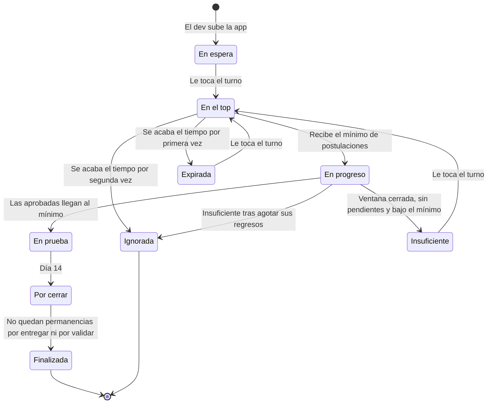

# PRD — Cola de testers para Google Play

@Carlos

## Resumen y problema

Una plataforma comunitaria donde las apps que deben pasar la prueba cerrada de Google Play avanzan en una cola: solo 5 apps se pueden probar a la vez, y cada una cede su lugar al conseguir el mínimo de postulantes de su plan: 12 en el gratuito, 15 en el de pago.

### Problema

Google exige a las cuentas personales de desarrollador nuevas un test cerrado con al menos 12 testers inscritos durante los últimos 14 días continuos antes de solicitar acceso a producción ([Ayuda de Play Console](https://support.google.com/googleplay/android-developer/answer/14151465)).

Las comunidades actuales de intercambio de testers funcionan como un feed. Con la llegada masiva de apps hechas con IA, una app publicada queda perdida en pocas horas: hay muchas apps, la mayoría con pocos testers, y completar la prueba cerrada se vuelve difícil.

### Propuesta de valor

- **Atención concentrada:** el top limita cuántas apps compiten por testers al mismo tiempo.
- **Turno visible:** cada dev ve su posición y recibe avisos a medida que se acerca.
- **Compromisos verificables:** capturas de instalación y de permanencia, rechazos públicos y una calificación visible para todos.
- **Gratis para empezar:** la primera app entra sin requisitos.

La plataforma consigue testers reales y comprometidos. No garantiza el acceso a producción: esa decisión es de Google.

## Regla base: la cadena de responsabilidad

Toda función, gratuita o de pago, actual o futura, debe respetar la cadena de responsabilidad: para subir otra app hay que aportar a la cola, con instalaciones aprobadas en apps de otros. La permanencia es un compromiso de confianza: no bloquea, pero queda visible para todos en la calificación. Las tareas del dev (validar y cerrar) tienen plazo y, si no las cumple, la plataforma las resuelve sola.

La primera app no exige nada. Desde la segunda, para subir la siguiente app el usuario necesita:

1. Que su app anterior ya no esté activa: Finalizada o Ignorada.
2. Las instalaciones aprobadas requeridas en apps de otros (3 en el lanzamiento) desde su último envío a la cola, sea al subir una app o al reencolarla.

Una instalación pendiente todavía no cuenta para el desbloqueo: cuenta recién cuando se aprueba, por el dev o sola. Las permanencias, sean pendientes, rechazadas o no entregadas, no bloquean. Lo que hace el usuario como dev tampoco bloquea ni afecta su calificación.

Es la regla sobre la que se sostiene la plataforma. Si una función permite saltarse una condición de la regla base, o evitar la captura de permanencia sin que baje la calificación, se rediseña o no se incluye.

> Para quien construya la plataforma, sean personas o agentes de IA: antes de agregar o cambiar una función, verificar que respete esta regla. Si no la respeta, no se implementa.

### Cómo evaluar una función nueva

1. ¿Permite subir una app sin cumplir las condiciones de la regla base? Entonces no se incluye.
2. ¿Permite evitar la captura de permanencia sin que afecte la calificación? Entonces no se incluye.
3. ¿Hace que un cambio de configuración afecte a una cuenta o a una app que ya empezó? Entonces se ajusta para que aplique solo a lo que empiece después (ver Cambios de configuración).
4. ¿Cambia cuánto o cómo se cumple, sin quitar ninguna obligación? Entonces se puede incluir.

### Funciones de pago evaluadas

| Función | ¿Respeta la cadena? | Por qué |
| --- | --- | --- |
| Apps adicionales, desde la tercera, con más postulantes (mínimo 15, hasta 20) | Sí | Cada app sigue requiriendo las dos condiciones de la regla base; el margen exige más testers y más validaciones al dev |
| Reencolar una app Finalizada | Sí | Crea un registro nuevo en la cola y exige las dos condiciones de la regla base; pagar no las reemplaza |
| Instalaciones requeridas distintas por plan | Sí, pero la debilita | Si el plan de pago exige menos, quien paga se lleva más testers y aporta menos: el pago reemplaza parte del aporte. Si exige más, castiga a quien paga. Lo recomendado es el mismo valor en ambos planes (ver Instalaciones requeridas por plan) |

## Cambios de configuración

Los parámetros (ver Parámetros configurables) se cambian en producción, sin deploy, para ajustar la cola con rapidez. Un cambio nunca afecta a lo que ya empezó: cada cuenta y cada app conservan los valores vigentes cuando empezaron, y el valor nuevo aplica solo a lo que empiece después. Esto vale también cuando el cambio favorece al usuario.

| Valor | Cuándo se toma el valor | Ejemplo |
| --- | --- | --- |
| Apps gratuitas en total | Al crear la cuenta | Un usuario creado con 2 apps gratuitas conserva 2, aunque el parámetro pase a 1 o a 3 |
| Instalaciones requeridas | En cada envío a la cola, sea al subir una app o al reencolarla. Se fijan los valores de ambos planes (ver Instalaciones requeridas por plan) | Quien sube su app con 3 requeridas necesita 3 para su siguiente envío, aunque el parámetro pase a 5 o a 2 |
| Mínimo y máximo de postulantes | Al enviar la app a la cola. Un regreso conserva los suyos; un registro reencolado toma los vigentes al reencolar | Una app subida con un mínimo de 12 necesita 12, aunque el parámetro pase a 13 mientras espera o vuelve como regreso |
| Tiempo en el top | Al entrar al top (ver Cola y top) | Una app que entra al top con 72 h las conserva, aunque el parámetro baje a 24 h |
| Grupo de Google propio | Al crear la app | Una app creada con su propio grupo lo conserva, también al reencolarla, aunque la función se desactive |
| Retención de capturas | Al enviar cada captura | Una captura enviada con 90 días de retención se borra a los 90 días, aunque el parámetro baje a 60 |

Para los demás parámetros falta verificar que un cambio no afecte a procesos en curso (ver [Propuesta para fijar los demás parámetros](#propuesta-para-fijar-los-demás-parámetros)).

## Objetivos y alcance del MVP

El MVP busca que cada app consiga los testers comprometidos de su plan sin que la cola se detenga.

### Objetivos

- Que cada app que llega al top consiga el mínimo de postulantes de su plan.
- Que la cola avance: ninguna app ocupa el top indefinidamente.
- Que los postulantes cumplan sus compromisos: las instalaciones, por la cadena de desbloqueo; las permanencias, por su calificación visible.
- Reunir datos sobre cómo terminó cada prueba cerrada.

### Señales para ajustar la cola

| Señal | Qué indica | Ajuste |
| --- | --- | --- |
| La cola crece semana a semana | Entran más apps de las que salen | Subir las instalaciones requeridas de ambos planes a la vez. El efecto se ve en el siguiente ciclo de cada usuario, unas 3 semanas después, así que conviene ajustarlo con tiempo |
| Las apps del top se llenan en minutos y los testers no encuentran dónde postularse | Hay más testers que apps disponibles | Ampliar el top |
| Los testers prefieren unirse a apps En progreso y las del top tardan más en llenarse | La ventana para postulantes adicionales le quita testers al top | Reducir la ventana para postulantes adicionales |
| Suben las permanencias no entregadas o rechazadas | La calificación no alcanza para que los postulantes permanezcan | Subir el máximo de postulantes del plan gratuito, subir las instalaciones requeridas de ambos planes o volver a evaluar si la permanencia debe bloquear la siguiente app. El resultado en Google Play, cuando el dev lo informa, es un dato complementario |
| Muchas apps reportadas agotan su tiempo en el top | Las apps que no funcionan ocupan lugares del top | Volver a evaluar qué hacer con las apps reportadas (ver Fuera del MVP) |

Cada ajuste aplica solo a lo que empieza después del cambio (ver Cambios de configuración).

### Incluido en el MVP

- Cola con top, estados, tiempos límite y reportes de apps que no abren.
- Postulaciones con capturas de instalación y de permanencia, validadas por el dev con aprobación automática.
- Cadena de desbloqueo por instalaciones aprobadas y calificación visible de permanencias.
- Rechazos y reportes públicos, sin sus capturas, y respuesta del dev a cada reporte.
- Plan gratuito y pago por uso.
- Notificaciones por email y web push en cada etapa.
- Parámetros configurables.
- Panel de administración (por definir; ver Pendientes).

### Fuera del alcance

- Garantizar el acceso a producción en Google Play.
- Validar automáticamente capturas, disponibilidad por país o apelaciones.
- Arquitectura técnica: se define en otra sesión.
- Baja de usuarios.
- Funciones posteriores al MVP, listadas en Pendientes.

## Terminología y principios

La plataforma no usa la palabra "aplicación": el software es una **app** y la acción del tester es una **postulación**.

### Terminología

| Término | Significado |
| --- | --- |
| App | El software que se sube para conseguir testers. Su nombre, su link de Google Play, su package name y sus grupos de Google no cambian después de crearse, ni al reencolarla. Tiene un registro en la cola, o varios si se reencola |
| Registro en la cola | Cada paso de una app por la cola. Tiene su estado, sus postulantes, sus capturas, sus regresos y sus reportes. Los postulantes se postulan a un registro, no a la app |
| Usuario | Una sola cuenta que actúa en dos roles: dev y postulante |
| Dev | El usuario cuando sube su app |
| Postulante | El usuario cuando se postula a la app de otro |
| Postulación | La acción de postularse; siempre incluye la captura de instalación |
| Captura de instalación | Prueba de que el postulante instaló la app (día 1) |
| Captura de permanencia | Prueba de que el postulante siguió en el test (día 14) |
| Validación | El dev aprueba o rechaza una captura; sin respuesta en plazo, se aprueba sola |
| Estado de una captura | Pendiente (por defecto), aprobada o rechazada; aplica a las capturas de instalación y de permanencia |
| Compromiso | Una obligación del postulante con plazo: instalar o permanecer |
| Cierre | El dev valida las permanencias de su app; si no lo hace, la plataforma la cierra al expirar su plazo |
| Calificación | Cuántas permanencias cumplió el usuario como postulante, sobre todas las que se resolvieron |
| Top | Las apps activas que pueden recibir postulaciones |
| Regreso | Un registro que vuelve a Waiting como Insuficiente o Expirada. Es el mismo registro que cambia de estado |
| Reencolar | Función de pago: crea un registro nuevo en la cola para una app Finalizada |
| Reporte | Aviso público de que la app no le funciona a quien reporta, con un motivo. No cambia el estado de la app. El dev puede responderlo una vez |
| Package name | El identificador de la app en Google Play, extraído de su link |

Postularse es enviar la captura de instalación. No es un compromiso propio: queda incluido en las instalaciones requeridas.

### Principios: confianza y contención

La plataforma equilibra dos sistemas para que la cola avance. **Confianza** es lo que queda a criterio de los usuarios. **Contención** es lo que la plataforma exige o restringe.

| Confianza | Contención |
| --- | --- |
| La primera app entra sin requisitos | Instalaciones aprobadas requeridas para subir la siguiente app |
| El dev valida las capturas | Aprobación automática al expirar el plazo |
| El postulante elige a qué apps postularse | El top limita cuántas apps compiten por testers al mismo tiempo |
| El dev declara que su app está disponible en todos los países | Tiempo límite en el top |
| El dev confirma que está en el grupo de Google y que su test cerrado usa los grupos de su app | Rechazos y reportes públicos |
| El dev responde a cada reporte | Cierre automático al expirar el plazo del dev para validar las permanencias |
| El dev informa su resultado en Google Play | Pago para reencolar una app Finalizada |
| Cada usuario decide si confía en otro según su calificación | |
| Cada postulante decide si se postula a una app reportada | |
| Las instalaciones aprobadas desbloquean la siguiente app sin esperar las permanencias | |
| Cada postulante decide si permanece; su calificación lo muestra | |

## Flujo y estados de una app

Una app avanza en línea recta de la cola al cierre, salvo cuando expira su tiempo en el top o queda Insuficiente. En esos casos vuelve a la cola como regreso, con un límite de veces, o termina Ignorada (ver Regresos). Los reportes no cambian su estado (ver Reportes).

| Estado | Qué pasa |
| --- | --- |
| En espera | Aguarda su turno; aparece en la cola si está entre las 20 próximas |
| En el top | Recibe postulaciones durante su tiempo límite y puede ser reportada |
| En progreso | Recibió el mínimo de capturas de su plan (12 o 15). Dura como máximo 24 h: el dev valida las capturas y, durante las primeras 12 h, acepta postulantes adicionales hasta el máximo (15 o 20) y puede ser reportada |
| Insuficiente | Terminó la ventana de postulantes adicionales, no quedan capturas pendientes y las aprobadas no llegan al mínimo; vuelve a la cola conservando sus aprobadas |
| Expirada | Se le acabó el tiempo en el top antes de recibir el mínimo de postulaciones; vuelve a la cola con sus postulantes |
| En prueba | Las capturas aprobadas llegaron al mínimo; nadie más puede unirse y corren los 14 días |
| Por cerrar | Desde que se cumplen los 14 días: los postulantes tienen 48 h para enviar su captura de permanencia y luego el dev tiene 24 h para validarlas |
| Finalizada | No queda ninguna permanencia por entregar ni por validar, porque el dev las validó o porque expiraron los plazos; el dev queda libre para su siguiente app |
| Ignorada | Se le acabó el tiempo en el top por segunda vez, o quedó Insuficiente otra vez después de agotar sus regresos; el dev queda libre para su siguiente app y la app sigue ocupando su espacio dentro de su total de apps. No se puede reencolar |

### Diagrama de estados

Reencolar no es una transición: crea un registro nuevo en la cola, que empieza en En espera. El registro anterior conserva su estado final.

### Cola visible y estados internos

La cola se muestra en tres partes, y cada una agrupa uno o más estados internos.

| Parte en la UI | Estados que incluye |
| --- | --- |
| Top | En el top |
| In progress | En progreso, solo durante su ventana de 12 h para postulantes adicionales |
| Waiting | En espera, Insuficiente y Expirada |

- Waiting muestra sus estados juntos, sin diferencia visual entre apps nuevas y regresos. Solo cambia el orden: primero las Insuficiente y después las nuevas y las Expirada, mezcladas.
- Dentro de cada grupo, las apps se ordenan por fecha de entrada a la cola: la de subida para una app nueva, la de reencolado para un registro reencolado y la de vuelta a la cola para un regreso.
- Una app En progreso deja de mostrarse al cerrarse su ventana de 12 h, aunque el dev siga validando.
- Las apps En prueba, Por cerrar, Finalizada e Ignorada no se muestran en la cola; el dev y sus postulantes las siguen viendo en sus apps y en sus pruebas.

### Historial de estados

Cada registro en la cola guarda el historial de sus transiciones: estado de origen, estado de destino, fecha y hora, y causa (acción del dev, expiración de un plazo o aprobación automática). También registra cómo se resolvió cada captura: por el dev o sola.

- Lo ven el dev de la app y el panel de administración; no es público.
- De él salen los conteos de regresos y expiraciones, los datos sobre cómo terminó cada prueba y la evidencia para decidir reembolsos.

## Reglas de operación

Cada dev tiene una sola app activa a la vez, que avanza según su turno en la cola y sale del top al conseguir el mínimo de postulantes de su plan: 12 en el gratuito, 15 en el de pago.

### Subida de una app

- El dev pega el link de Google Play de su test cerrado; la plataforma extrae el package name.
- Cada package name pertenece a una sola cuenta: la primera que lo registra.
- El dev marca una casilla confirmando que la app está disponible en todos los países.
- El test cerrado usa el grupo de Google de la plataforma. Si la función de grupo propio está activa (ver Parámetros configurables), al subir la app el dev puede agregar también su propio grupo. Los grupos quedan fijados al crear la app.
- Cada usuario se une al grupo de Google de la plataforma por su cuenta. Al subir su primera app, el dev confirma con una casilla que ya está en el grupo. En cada app que sube, confirma con otra casilla que su test cerrado usa los grupos de la app. Ninguna de las dos se verifica.
- Si la app tiene un grupo propio, la plataforma muestra su enlace y el postulante se une a él antes de instalar.
- Una vez subida, el dev no puede retirar la app ni cambiar su link de Google Play. Un link incorrecto es responsabilidad del dev.
- La primera app entra sin requisitos. Las siguientes dependen de la cadena de desbloqueo (ver Compromisos).
- Una app activa a la vez por dev, en plan gratuito y de pago. Una app deja de estar activa al llegar a Finalizada o Ignorada. Al reencolarse, vuelve a estar activa hasta que su registro nuevo llegue a uno de esos estados.
- La pantalla de subida muestra el aviso de que la plataforma no garantiza el acceso a producción.
- Una app Finalizada se puede reencolar pagando, sin límite; por ejemplo, si Google pidió otra prueba cerrada antes de dar acceso a producción.
- Una app Ignorada no se puede reencolar, ni pagando.
- Una app que nunca se subió sigue las reglas normales: es gratuita si al usuario le quedan apps gratuitas.
- Reencolar crea un registro nuevo en la cola: empieza sin postulantes ni reportes, y los reportes de sus registros anteriores siguen siendo públicos. En Waiting aparece como una app nueva.
- Reencolar exige las dos condiciones de la regla base. Las instalaciones requeridas siguen la misma regla que al subir una app nueva: reencolar no tiene parámetros propios.
- Reencolar no ocupa otro espacio en el total de apps del dev: la app ocupa uno solo, tenga uno o varios registros. El registro nuevo sí ocupa su lugar en la cola y recibe el mínimo y el máximo del plan de pago.
- Solo la cuenta dueña del package name puede reencolar la app.

### Cola y top

- La cola se ordena por grupos y, dentro de cada grupo, por fecha de entrada (ver Cola visible y estados internos). Se muestran las 20 próximas apps y la calificación de cada dev.
- Hay 5 apps en el top. Una app entra al top cuando le toca su turno.
- Tiempo en el top: 72 h en el lanzamiento, luego 24 h. Si se acaba antes de recibir el mínimo de postulaciones, la app pasa a Expirada y vuelve a la cola; si le pasa por segunda vez, pasa a Ignorada (ver Regresos).
- Cada app tiene su propio tiempo límite: se calcula al entrar al top, con el valor vigente del parámetro que le corresponde (el normal o el de su tipo de regreso). Si un parámetro cambia, solo afecta a las apps que entren al top después; las que ya están conservan su tiempo límite.
- Al recibir el mínimo de postulaciones de su plan (12 gratis, 15 de pago), la app pasa a En progreso y libera su lugar.
- En progreso dura como máximo 24 h. Durante sus primeras 12 h acepta postulantes adicionales hasta el máximo de su plan (15 gratis, 20 de pago); las capturas de los adicionales también cuentan para completar el mínimo.
- En cuanto las capturas aprobadas llegan al mínimo, por el dev o por aprobación automática, la app pasa a En prueba y deja de mostrarse en la cola, aunque no hayan pasado las 12 h.
- Si termina la ventana de postulantes adicionales, no quedan capturas pendientes y las aprobadas no llegan al mínimo, la app pasa a Insuficiente y vuelve a la cola (ver Regresos). Mientras quede una captura pendiente o la ventana siga abierta, la app sigue En progreso.

| Caso (plan gratis: mínimo 12) | Resultado |
| --- | --- |
| El dev aprueba 12 en la hora 3 | Pasa a En prueba en la hora 3 |
| Rechaza 1 en la hora 5 y no llega ningún adicional | Espera al cierre de la ventana, en la hora 12, y pasa a Insuficiente |
| Rechaza 1 en la hora 5; llega un adicional en la hora 8 y el dev no lo revisa | Se aprueba solo en la hora 24 y pasa a En prueba |
| Rechaza a ese adicional en la hora 13 | Sin pendientes, ventana cerrada y 11 aprobadas: pasa a Insuficiente |
| El dev no revisa nada | Todo se aprueba solo en la hora 24 y pasa a En prueba |

### Regresos

Un regreso es el mismo registro que vuelve a Waiting: conserva lo que ya consiguió y, al volver al top, solo necesita lo que le falta.

| Regreso | Qué conserva | Tiempo en el top al volver | Límite |
| --- | --- | --- | --- |
| Insuficiente | Sus capturas aprobadas; las rechazadas no cuentan | 6 h | 2 regresos; si queda Insuficiente una tercera vez, pasa a Ignorada |
| Expirada | Todos sus postulantes, incluidas las capturas pendientes, que se siguen aprobando solas | 12 h | 1 regreso; la segunda expiración la deja Ignorada |

- Las expiraciones se cuentan por registro en la cola, sin importar de dónde venga la app: la primera vez que se le acaba el tiempo en el top, sea nueva o un regreso, pasa a Expirada; la segunda, a Ignorada.
- Cada tipo de regreso tiene su propio contador.
- Al volver a llegar a su mínimo, el regreso pasa otra vez por En progreso con las mismas reglas: 24 h en total y 12 h para postulantes adicionales.
- Un regreso conserva sus reportes y las respuestas del dev, que siguen visibles al volver al top.
- El tiempo y el límite de Insuficiente son parámetros (ver Parámetros configurables). El regreso único de Expirada es fijo.

### Postulaciones y capturas

- Postularse es enviar la captura de instalación. No hay límite de postulaciones simultáneas.
- La postulación es a un registro en la cola, no a la app. Si una app se reencola, quienes se postularon a un registro anterior pueden postularse al nuevo, y esa es una instalación nueva.
- Toda captura, de instalación o de permanencia, empieza como pendiente y pasa a aprobada o rechazada.
- Una captura rechazada no se puede reenviar: el rechazo es definitivo y no se puede apelar.

Una captura de instalación cuenta distinto para la app del dev y para el postulante, según su estado:

| Captura de instalación | Para la app del dev | Para el postulante |
| --- | --- | --- |
| Enviada (pendiente) | Cuenta para el mínimo de postulaciones que la saca del top | Todavía no cuenta |
| Aprobada | Cuenta para el mínimo de aprobadas que la lleva a En prueba | Cuenta para desbloquear su siguiente app |
| Rechazada | Deja de contar para En prueba | No desbloquea. El rechazo es público, pero no afecta su calificación |

- El dev valida todas las postulaciones que recibe, hasta el máximo de su plan. Tiene 24 h por captura y recibe un recordatorio 6 h antes de que se aprueben solas. En En progreso el límite es único: todas las capturas pendientes se aprueban solas como tarde a las 24 h de que la app entró en ese estado, incluidas las de los postulantes adicionales. La demora del dev nunca castiga al postulante.
- Un rechazo requiere una justificación escrita de 30 a 280 caracteres y se basa en la captura, nunca en la calificación del postulante.
- Los 14 días empiezan cuando las capturas aprobadas llegan al mínimo de su plan (12 o 15) y la app pasa a En prueba. La plataforma muestra al dev dos fechas: desde cuándo puede solicitar producción a Google y la fecha en que su app se cierra a más tardar. Ambas se calculan para cada app al pasar a En prueba, con los valores vigentes en ese momento. La fecha de cierre suma dos plazos desde que se cumplen los 14 días: la ventana para enviar las capturas de permanencia (48 h) y el plazo del dev para validarlas (24 h).
- Los postulantes adicionales se unen antes de que empiecen los 14 días, así que el día 14 y la ventana de permanencia son los mismos para todos los postulantes de la app.
- La captura de permanencia se envía cuando se cumplen los 14 días, dentro de una ventana de 48 h. Si el postulante no la envía, cuenta como no cumplida en su calificación.
- El dev valida las capturas de permanencia, con una justificación escrita para cada rechazo; sin respuesta dentro de su plazo, se aprueban solas (ver Cierre). El rechazo no se puede apelar y cuenta como no cumplida en la calificación del postulante; no bloquea su siguiente app.

### Cierre

El cierre tiene dos partes:

| Momento | Qué pasa |
| --- | --- |
| Se cumplen los 14 días en prueba | Se abre la ventana de permanencia: cada postulante tiene 48 h para enviar su captura. Recibe un aviso al abrirse y otro 12 h antes de que se cierre la ventana |
| Se cierra la ventana | Quien no envió su captura incumplió. Empieza el plazo del dev: 24 h para validar todas las capturas de permanencia |
| Expira el plazo del dev | Las capturas que no revisó se aprueban solas y la plataforma cierra la app |

- El dev puede validar cada captura apenas llega, sin esperar a que se cierre la ventana. El plazo de 24 h es único para todas las capturas y se cuenta desde que se cierra la ventana.
- El dev no puede cerrar con permanencias pendientes. Aprobar o rechazar todas las capturas, una vez que todos entregaron o se cerró la ventana, es lo que cierra la app de forma manual.
- La app se finaliza en cuanto no queda ninguna permanencia por entregar ni por validar. Si todos los postulantes entregaron y el dev ya las validó todas, se finaliza sin esperar los plazos. Validar antes libera antes al dev para su siguiente app.
- Cerrar es una obligación del dev, pero no cumplirla no tiene consecuencias para él: la plataforma la cierra.
- La captura de Play Console, que muestra si se cumplió el requisito del test cerrado, y el resultado en Google Play (aprobada o rechazada, y si el rechazo tuvo que ver con los testers) son opcionales e informativos. El dev los puede informar cuando quiera, incluso después de que la app se finalizó.

### Reportes

Un reporte avisa a los demás usuarios que la app no le funciona a quien reporta. Es informativo: no cambia el estado de la app ni la saca del top. Cada usuario decide si se postula a una app reportada, igual que decide según la calificación del dev. Así la plataforma no tiene que decidir quién tiene razón, y ninguna app sale del top por reportes injustos. Si los usuarios no se postulan, la app sale al vencerse su tiempo en el top.

- Cualquier usuario puede reportar una app mientras se puede postular a ella: en el top y durante las primeras 12 h de En progreso. También puede hacerlo quien ya se postuló. El dev no puede reportar su propia app.
- Cada usuario reporta una sola vez por registro en la cola.
- Cada reporte lleva un motivo (no abre, no disponible en mi país, pide login, se cierra o no puedo unirme a su grupo de Google), una justificación escrita de 30 a 280 caracteres y, de forma opcional, una captura.
- El dev puede responder cada reporte una sola vez, con una justificación del mismo largo, mientras su app puede recibir reportes: en el top y durante las primeras 12 h de En progreso. Así puede indicar, por ejemplo, que ya la arregló.
- Un reporte y su respuesta no se pueden editar ni borrar.
- Los reportes no afectan la calificación de nadie: ni la de quien reporta ni la del dev.
- La cola muestra junto a cada app cuántos reportes tiene. La ficha de la app muestra cada reporte con su respuesta.
- Los reportes son del registro en la cola: un regreso los conserva y un registro reencolado empieza sin reportes.
- Qué hacer con las apps reportadas, por ejemplo pausarlas, queda fuera del MVP (ver Fuera del MVP).

### Transparencia de rechazos y reportes

Los rechazos y los reportes son públicos, para que cada usuario pueda juzgar a los demás por lo que hacen. Se muestra todo lo que no comprometa a nadie: nunca las capturas.

- Todos los que participan en la prueba de una app ven los rechazos del dev: a qué postulante, el tipo de captura, el motivo y la justificación.
- Los reportes de una app son públicos: quién reportó, el motivo, la justificación y la respuesta del dev.
- El perfil de cada usuario muestra los rechazos que hizo como dev y los que recibió como postulante.

## Compromisos, desbloqueo y calificación

Cumplir las instalaciones desbloquea la siguiente app. Cumplir las permanencias define la calificación visible de cada usuario.

### Compromisos

| Compromiso del postulante | Plazo | Si no cumple |
| --- | --- | --- |
| Instalar: las capturas de instalación aprobadas requeridas en apps de otros (3 en el lanzamiento) | Desde su último envío a la cola, antes del siguiente | No puede subir su siguiente app ni reencolar |
| Permanencia | 48 h desde que se cumplen los 14 días | Cuenta como no cumplida en su calificación |

Las tareas del dev no son compromisos: no cumplirlas no bloquea ni afecta su calificación.

| Tarea del dev | Plazo | Si no la hace |
| --- | --- | --- |
| Validar las capturas de instalación | 24 h por captura; en En progreso, como tarde 24 h desde que la app entró en ese estado | Se aprueban solas |
| Validar las capturas de permanencia (cerrar) | 24 h desde que se cierra la ventana de permanencia | Se aprueban solas y la plataforma cierra la app |
| Informar el resultado en Google Play | Cuando quiera | Es opcional |

### Cadena de desbloqueo

- La primera app no requiere compromisos previos. Así se alimenta la plataforma.
- Desde la segunda, el usuario sube su siguiente app al cumplir las dos condiciones de la regla base.
- Instalar es obligatorio: cuentan las capturas de instalación del usuario como postulante, en apps de otros, aprobadas desde la última vez que envió una app a la cola, sea al subirla o al reencolarla. Las capturas pendientes no cuentan hasta que se aprueban; una que se aprueba después de un envío cuenta para el ciclo siguiente.
- Cada envío a la cola cierra el ciclo: las instalaciones usadas no vuelven a contar y las que sobran no pasan al ciclo siguiente.
- Las instalaciones requeridas se exigen en cada envío a la cola después del primero, sea una app nueva o un reencolado: 3 para el segundo envío, otras 3 para el tercero, y así. Cuántas se exigen depende de un parámetro por plan (ver Instalaciones requeridas por plan).
- Las instalaciones aprobadas desbloquean la siguiente app sin esperar los 14 días. Las permanencias de esas postulaciones no bloquean, se cumplan o no.
- La cadena aplica igual en el plan de pago: pagar quita el límite de cantidad, no las condiciones de la regla base.
- Si una app termina Ignorada, el dev queda libre para su siguiente app y la app sigue ocupando su espacio dentro de su total, incluidas las 2 gratuitas. No se puede reencolar.
- Si la app a la que se postuló termina Ignorada, el postulante no tiene permanencia pendiente, porque los 14 días nunca empezaron. Su instalación aprobada cuenta igual para su siguiente app.

#### Instalaciones requeridas por plan

Hay dos parámetros, uno por plan. Ambos empiezan en 3 y nunca bajan de 1, que es el mínimo de la regla base. Cuál rige depende de lo que el usuario envía a la cola:

| Envío | Parámetro que rige |
| --- | --- |
| App nueva, si al usuario le quedan apps gratuitas | El del plan gratuito |
| App nueva, si ya no le quedan apps gratuitas | El del plan de pago |
| Reencolado | El del plan de pago, porque reencolar siempre se paga |

**Lo recomendado es que ambos parámetros tengan el mismo valor.** Valores distintos debilitan la cadena de responsabilidad:

| Si el valor del plan de pago es… | Qué pasa |
| --- | --- |
| Menor que el del gratuito | Quien paga se lleva más testers (hasta 20, contra 15 del plan gratuito) y aporta menos. El pago reemplaza parte del aporte, y la regla base dice que pagar no reemplaza sus condiciones |
| Mayor que el del gratuito | Castiga a quien paga. Además, mientras le quedan apps gratuitas, el usuario elige entre subir una app nueva o reencolar según cuál le exige menos instalaciones |
| Igual | Hay un solo número por ciclo, que no depende de lo que el usuario envíe después |

Se mantienen dos parámetros para poder separarlos en producción, sin deploy, si los datos lo justifican.

Cada envío a la cola fija los valores vigentes de ambos parámetros, porque en ese momento no se sabe si el siguiente envío será una app gratuita, una de pago o un reencolado. En el siguiente envío rige el valor fijado que corresponde. Si un parámetro cambia después, no le afecta: el valor nuevo le aplica desde el envío siguiente (ver Cambios de configuración). Con ambos parámetros iguales, es un solo número.

Ejemplo: un usuario sube su primera app con ambos parámetros en 3. Una semana después, los dos pasan a 5. Para su segundo envío, sea su segunda app o reencolar la primera, necesita 3 instalaciones aprobadas. Al hacer ese envío quedan fijados 5 y 5 para el siguiente.

### Calificación

La calificación mide solo cómo cumple cada usuario sus permanencias como postulante. Nadie califica a nadie y lo que hace como dev no cuenta.

- **Formato:** "11 de 12 permanencias cumplidas".
- **Cumplida:** la captura se entregó dentro de la ventana y se aprobó, por el dev o sola.
- **No cumplida:** la captura no se entregó a tiempo o el dev la rechazó.
- **Pendiente:** no cuenta hasta que se resuelve.
- **Período:** todo el historial del usuario.
- **Cuentas nuevas:** muestran la insignia "Nuevo" hasta su primera permanencia resuelta, sea aprobada, rechazada o no entregada.
- **Visible:** aparece en la cola, junto a cada dev, y en las postulaciones. El perfil muestra cuántas permanencias no se entregaron y cuántas se rechazaron.
- **En la cola:** como mide cuánto permanece cada uno en las apps de otros, los postulantes pueden usarla para elegir a qué devs ayudar.
- **No bloquea:** es informativa. El dev ve la calificación de quienes se postulan, pero no puede rechazar a nadie por ella: el rechazo se basa en la captura. Una calificación mínima para subir otra app queda fuera del MVP (ver Pendientes).

## Planes, pagos y reembolsos

El modelo es de pago por uso, sin suscripción: se paga por cada app después de las 2 gratuitas y por cada reencolado.

| Plan | Apps en total | Apps activas a la vez | Mínimo para avanzar | Máximo de postulantes | Costo |
| --- | --- | --- | --- | --- | --- |
| Gratis | 2 | 1 | 12 | 15 | Sin costo |
| Pago por uso | Ilimitadas | 1 | 15 | 20 | Un pago por cada app adicional y por cada reencolado (precio por definir) |

Las 2 primeras apps de cada usuario son siempre gratuitas, para facilitar la entrada; no se puede pagar al subirlas para obtener el margen del plan de pago. Desde la tercera, cada app se paga e incluye el mínimo y el máximo del plan de pago: no son compras separadas. Su margen extra de postulantes reduce el riesgo de quedar por debajo de los 12 testers que exige Google si alguno abandona.

Una app Ignorada sigue ocupando su espacio dentro de ese total. Si era gratuita, consumió una de las 2 gratuitas.

Reencolar una app Finalizada se paga siempre, al mismo precio que una app de pago, aunque al usuario le queden apps gratuitas. No ocupa otro espacio en su total. El registro nuevo recibe el mínimo y el máximo del plan de pago.

### Reembolsos

Solo se reembolsa lo pagado cuando falla la plataforma; por ejemplo, se cobró una app que no entró a la cola, o la app desapareció de la cola por un error del sistema. Nada que dependa de la app o del dev se reembolsa.

### Usuarios que agotan sus apps gratuitas

Pueden seguir postulándose como testers y manteniendo su calificación. La plataforma los invita a seguir activos y a pasar al pago por uso: son los testers con historial que la cola necesita.

## Notificaciones

La plataforma avisa en cada etapa del proceso, por email y con notificaciones web push del navegador. Los avisos de posición se basan en cuántas posiciones faltan, no en tiempos estimados.

| Evento | Para | Ejemplo |
| --- | --- | --- |
| A 10 posiciones de las 20 visibles | Dev | "Tu app está cerca de aparecer en la cola" |
| Entra a las 20 visibles | Dev | "Tu app ya aparece en la cola" |
| A 3 posiciones del top | Dev | "Estás a 3 posiciones del top" |
| Entra al top | Dev | "Tu app está en el top y ya recibe postulaciones" |
| Recibe postulaciones | Dev | "Tienes 4 capturas por validar" |
| Recibe un reporte | Dev | "Tu app recibió un reporte: no abre" |
| El dev responde un reporte | Usuario que reportó | "El dev respondió tu reporte" |
| 6 h antes de que las capturas de instalación se aprueben solas | Dev | "Tus capturas se aprueban solas en 6 h" |
| Expira el tiempo en el top | Dev | "Tu app volvió a la cola con sus postulantes" |
| Pasa a En progreso | Dev | "Alcanzaste tu mínimo de postulantes: valida sus capturas" |
| Pasa a En prueba | Dev y postulantes | "Se aprobó el mínimo de capturas: empiezan los 14 días" |
| Pasa a Insuficiente | Dev | "Tu app no llegó al mínimo de capturas aprobadas" |
| Vuelve a la cola como Insuficiente | Dev | "Tu app volvió a la cola en la posición 3" |
| Captura aprobada o rechazada | Postulante | "Rechazaron tu captura: no se ve la app instalada" |
| Se abre la ventana de permanencia | Postulante | "Hoy toca tu captura de permanencia: tienes 48 h para enviarla" |
| 12 h antes de que se cierre la ventana de permanencia | Postulante | "Te quedan 12 h para enviar tu captura de permanencia" |
| Se cerró la ventana sin su captura | Postulante | "No enviaste tu captura de permanencia: cuenta como no cumplida en tu calificación" |
| Se cierra la ventana de permanencia | Dev | "Tienes 24 h para validar las permanencias de tu app" |
| 6 h antes de que las permanencias se aprueben solas | Dev | "Tus permanencias se aprueban solas en 6 h" |
| Pasa a Finalizada | Dev | "Tu app se cerró. Ya puedes informar cómo te fue en Google Play" |
| Pasa a Ignorada | Dev | "Tu app no consiguió su mínimo de postulantes y quedó ignorada" |
| Pasa a Ignorada | Postulantes | "Tu instalación cuenta para tu siguiente app; no tienes permanencia pendiente" |
| Siguiente app desbloqueada | Usuario | "Ya puedes subir tu siguiente app" |

## Parámetros configurables

Casi todas las reglas dependen de un parámetro. El valor inicial es el número con el que arranca el lanzamiento, y se ajusta con las señales de la cola. Los parámetros se cambian en producción sin deploy, y un cambio no afecta a lo que ya empezó (ver Cambios de configuración).

### Cola

| Parámetro | Tipo | Valores aceptados | Inicial |
| --- | --- | --- | --- |
| Tamaño del top | Número | 1–20 | 5 |
| Apps visibles en la cola | Número | 10–100 | 20 |
| Mínimo de postulantes, plan gratuito | Número | 12–20 | 12 |
| Máximo de postulantes, plan gratuito | Número | Desde su mínimo hasta 30 | 15 |
| Mínimo de postulantes, plan de pago | Número | 12–20 | 15 |
| Máximo de postulantes, plan de pago | Número | Desde su mínimo hasta 30 | 20 |
| Tiempo en el top | Horas | 12–168 | 72 (luego 24) |
| Tiempo en el top al volver como Insuficiente | Horas | 1–24 | 6 |
| Tiempo en el top al volver como Expirada | Horas | 1–24 | 12 |
| Regresos a la cola como Insuficiente | Número | 0–5 | 2 |
| Ventana para postulantes adicionales | Horas desde que la app entra En progreso | Menor que el plazo del dev para validar | 12 |

### Capturas y validación

| Parámetro | Tipo | Valores aceptados | Inicial |
| --- | --- | --- | --- |
| Plazo del dev para validar | Horas | 12–72 | 24. Para las permanencias se cuenta desde que se cierra la ventana |
| Recordatorio antes de la aprobación automática | Horas antes | 1–12 | 6 |
| Ventana para la captura de permanencia | Horas desde que se cumplen los 14 días | 24–96 | 48 |
| Aviso antes de que se cierre la ventana de permanencia | Horas antes | 1–24 | 12 |
| Justificación de rechazos, reportes y respuestas: mínimo | Caracteres | 10–100 | 30 |
| Justificación de rechazos, reportes y respuestas: máximo | Caracteres | 100–500 | 280 |
| Retención de capturas | Días desde que se envía cada captura | 30–365 | 90 |

### Avisos de posición

| Parámetro | Tipo | Valores aceptados | Inicial |
| --- | --- | --- | --- |
| Aviso de cercanía a la lista visible | Posiciones antes | 5–50 | 10 |
| Aviso de cercanía al top | Posiciones antes | 1–10 | 3 |

### Planes y funciones

| Parámetro | Tipo | Valores aceptados | Inicial |
| --- | --- | --- | --- |
| Apps gratuitas en total | Número | 1–10 | 2 |
| Instalaciones aprobadas requeridas para subir una app gratuita, desde el envío anterior | Número | 1–15 | 3 |
| Instalaciones aprobadas requeridas para subir una app de pago o reencolar, desde el envío anterior | Número | 1–15 | 3 |
| Apps activas a la vez por dev | Número | Fijo en 1 durante el MVP | 1 |
| Grupo de Google propio por app | Feature flag | Activo · Inactivo | Inactivo |

Lo recomendado es que las instalaciones requeridas de ambos planes tengan el mismo valor: valores distintos debilitan la cadena de responsabilidad (ver Instalaciones requeridas por plan).

## Riesgos asumidos, privacidad y avisos

El MVP acepta varios riesgos a cambio de simplicidad y de no castigar a usuarios honestos; cada uno tiene una mitigación parcial.

### Riesgos asumidos

| Riesgo | Por qué se asume | Mitigación |
| --- | --- | --- |
| La primera app libre atrae apps de usuarios que nunca prueban otras | Sin ella la plataforma no arranca | Instalaciones requeridas para subir la segunda app (parámetro); package name único |
| Postulantes que no entregan la permanencia | La permanencia no bloquea; queda a criterio de cada postulante | Calificación visible sobre todo el historial; aviso al abrirse la ventana y otro antes de que se cierre; margen de postulantes del plan de pago |
| Las instalaciones aprobadas desbloquean la siguiente app antes de las permanencias | Esperar 14 días por cada app aleja a los devs con varias apps por subir | La calificación muestra las permanencias no cumplidas |
| Postulantes de paso: consiguen sus instalaciones aprobadas, suben su siguiente app y salen de los tests antes del día 14 | Bloquear por la permanencia agrega condiciones a la regla base y la vuelve difícil de seguir | Calificación visible; los postulantes pueden elegir a qué devs ayudar según su calificación; margen del plan de pago; señal para volver a evaluar |
| Devs que no validan ni cierran | Lo que hace como dev no afecta su calificación ni bloquea | Aprobación automática y cierre automático; validar antes lo libera antes para su siguiente app; el historial de estados registra cada aprobación automática |
| Postulantes que envían capturas malas en muchas apps | Pocas instalaciones aprobadas (3 en el lanzamiento) desbloquean la siguiente app | Rechazos públicos y validación del dev |
| Capturas falsas aprobadas automáticamente | Es mejor que castigar al postulante por la demora del dev | Recordatorio al dev. Sin detección de duplicados, el dev es el único filtro |
| Capturas reutilizadas sin detección de duplicados | La detección queda fuera del MVP | Validación del dev y rechazos públicos |
| Calificación inflada por permanencias aprobadas solas | El dev no está obligado a validar | Validar antes libera antes al dev; el historial de estados permite medir la proporción de aprobaciones automáticas |
| Rechazos injustos del dev | No hay moderación ni apelación en el MVP | Un rechazo de permanencia no bloquea: solo cuenta en la calificación. Justificación escrita obligatoria y rechazos públicos |
| El dev no puede actuar según la calificación del postulante | El rechazo se basa en la captura, nunca en la calificación | La calificación sirve del lado del postulante, que elige a qué devs ayudar |
| Una permanencia no cumplida queda para siempre en la calificación | La calificación cubre todo el historial | Ventana de 48 h y aviso antes de que se cierre |
| Al lanzamiento, todos los usuarios muestran "Nuevo" durante las primeras semanas | La primera permanencia se resuelve recién después de los 14 días | Se deja de ser "Nuevo" con la primera permanencia resuelta |
| Reportes falsos o malintencionados | Cualquiera puede reportar | Los reportes no sacan a la app del top; son públicos y el dev puede responder cada uno |
| Una app que no funciona ocupa un lugar del top hasta que se vence su tiempo | Sacar apps del top por reportes obliga a la plataforma a decidir quién tiene razón | Reportes públicos; tiempo límite en el top; señal para volver a evaluar (ver Señales para ajustar la cola) |
| Disponibilidad por país declarada sin verificar | No se puede validar de forma automática | Reportes públicos |
| Grupo de Google confirmado sin verificar | No hay conexión con Google Play | Reportes públicos |
| Link de Google Play incorrecto | No se puede corregir después de subir la app; es responsabilidad del dev | Reportes públicos |
| Postulantes que salen del test antes del día 14 | No hay conexión con Google Play ni forma de detectarlo | Captura de permanencia y su rechazo por el dev |
| Una persona con varias cuentas | Verificar identidad queda fuera del MVP | Package name único y calificación |
| Un dev que abandona la plataforma | No hay forma de obligarlo a volver | Aprobación automática y cierre automático |
| Participación mínima: abrir la app solo para la captura | Las capturas prueban que se abrió, no que se usó | Aviso de que no se garantiza la aprobación de Google |
| Apps gratuitas que avanzan con solo 12 postulantes, sin margen | Es el mínimo de Google, y la permanencia no bloquea | Aceptan hasta 15 postulantes; se avisa al dev que un abandono puede dejarlo por debajo de 12 |
| Pocos datos sobre el resultado en Google Play | Informarlo es opcional | La señal para volver a evaluar se basa en las permanencias no entregadas y rechazadas |

### Privacidad de las capturas

- Una captura puede mostrar el email, la foto o las notificaciones del postulante. La plataforma le pide recortar o tapar datos personales antes de enviarla.
- Solo el dev de esa app ve las capturas. Los rechazos y reportes son públicos, pero sin sus capturas.
- Todas las capturas (de instalación, de permanencia, de reportes y de Play Console) se borran al cumplirse el plazo de retención, contado desde que se envía cada una: 90 días en el lanzamiento (ver Parámetros configurables). El plazo queda fijado al enviar la captura y no depende de cómo termine la app.

### Baja de usuarios

La baja de usuarios queda fuera del MVP: en el lanzamiento no se pueden eliminar cuentas.

### Aviso en los términos y en la pantalla de subida

> La plataforma te ayuda a conseguir testers reales y comprometidos, pero no garantiza el acceso a producción. Esa decisión es de Google.

La captura de Play Console y el resultado en Google Play son informativos y alimentan las estadísticas de la plataforma.

## Propuesta para fijar los demás parámetros

Propuesta para el pendiente [Verificar que los cambios a nivel de sistema no afecten a procesos en curso](#por-decidir-dentro-del-mvp). Indica en qué momento se toma el valor de cada parámetro que todavía no figura en [Cambios de configuración](#cambios-de-configuración) y si conviene resolverlo antes del MVP o puede esperar. Cuando se apruebe, cada fila pasa a esa tabla.

Algunos parámetros no se fijan por cuenta ni por app: valen para toda la plataforma o solo cambian lo que se muestra. Esos aplican de inmediato, con una regla que evita efectos sobre lo que ya empezó.

El costo de cerrar un parámetro es lo que se mueve en el resto de la plataforma al fijarlo: otros parámetros que dependen de él, reglas que hay que ajustar y pantallas o avisos que cambian. No mide el esfuerzo de programarlo.

| Costo | Significado |
| --- | --- |
| Bajo | Se fija en un momento que ya existe y no toca nada más |
| Medio | Obliga a ajustar otro parámetro, una pantalla o un aviso |
| Alto | Abre una decisión nueva en una regla del PRD |

### Resolver antes del MVP

Están aquí porque aparecen en las señales para ajustar la cola (filas 1 y 2) o porque siempre hay algo en curso que el cambio dañaría sin vuelta atrás (filas 3 a 5).

| # | Parámetro | Qué pasa si cambia sin regla | Cuándo se toma el valor | Costo | Efectos secundarios |
| --- | --- | --- | --- | --- | --- |
| 1 | Tamaño del top | Si baja de 5 a 3 con 5 apps en el top, no está claro si 2 salen antes de tiempo | No se toma: aplica de inmediato y no saca a ninguna app: las que están en el top se quedan hasta salir por sus reglas, y no entra ninguna nueva hasta que queden menos que el nuevo tamaño. Si sube, entran apps de inmediato | Medio | Si baja, el top muestra más apps que el nuevo tamaño hasta que salgan, y Waiting no avanza mientras tanto. Si sube, varias apps entran juntas: empiezan su tiempo en el top a la vez y se envían en bloque los avisos de entrada al top y los de posición de las apps que avanzan en Waiting |
| 2 | Ventana para postulantes adicionales | Si baja de 12 h a 6 h en la hora 8, la ventana se cierra en el acto | Al entrar En progreso, junto con el plazo del dev de ese estado, para que la ventana siga siendo menor que el plazo | Alto | Arrastra al plazo del dev, que se fija en el mismo momento. El panel debe impedir un plazo del dev menor o igual a la ventana. Abre una decisión sobre los regresos (ver Notas) |
| 3 | Plazo del dev para validar, en las capturas de instalación | Si baja, las capturas se aprueban solas antes de lo anunciado; si sube, el postulante espera más | Al enviar cada captura. En En progreso, al entrar en ese estado, porque el límite es único | Medio | El mismo parámetro queda fijado en tres momentos: al enviar cada captura, al entrar En progreso y, para las permanencias, al pasar a En prueba (fila 4). El recordatorio (fila 8) debe seguir siendo menor que el plazo. Decide cuándo se aprueba una instalación y, con eso, si cuenta para el ciclo actual del postulante o para el siguiente |
| 4 | Plazo del dev para validar, en las capturas de permanencia | Cambia la fecha de cierre que ya se le mostró al dev | Al pasar a En prueba, junto con la fecha de cierre (ver Postulaciones y capturas) | Bajo | Ninguno: la fecha de cierre ya se calcula al pasar a En prueba con los valores vigentes |
| 5 | Ventana para la captura de permanencia | Si baja de 48 h a 24 h, quien pensaba enviarla en la hora 30 queda como no cumplida en su calificación | Al pasar a En prueba, igual para todos los postulantes de la app | Bajo | Se fija junto con la fecha de cierre (fila 4). El aviso antes del cierre (fila 9) debe seguir siendo menor que la ventana; si son iguales, coincide con el aviso de apertura |

### Pueden esperar

Ninguno aparece en las señales para ajustar la cola. Si cambian, el daño es menor; el que no tiene ese margen (fila 7) queda fijo durante el MVP.

| # | Parámetro | Qué pasa si cambia sin regla | Cuándo se toma el valor | Costo | Efectos secundarios |
| --- | --- | --- | --- | --- | --- |
| 6 | Apps visibles en la cola | Si pasa de 20 a 30, aparecen 10 apps de golpe y no está claro si reciben el aviso | No se toma: aplica de inmediato, porque solo cambia lo que se muestra. Los avisos no se envían de forma retroactiva y cada uno se envía una sola vez por paso por Waiting | Bajo | Mueve el umbral del aviso de cercanía a la lista visible (fila 11), que se cuenta desde el final de la lista. Depende del aviso único de posición (ver Notas) |
| 7 | Regresos a la cola como Insuficiente | Si el límite baja de 2 a 1, un registro que ya usó un regreso pasa a Ignorada en el siguiente, aunque al entrar tenía 2 | Al enviar la app a la cola, igual que el mínimo y el máximo de postulantes. Un regreso conserva el suyo; un registro reencolado toma el vigente | Bajo | Ninguno: se guarda junto con el mínimo y el máximo de postulantes |
| 8 | Recordatorio antes de la aprobación automática | El aviso al dev se salta o se repite | Junto con el plazo al que recuerda: al enviar cada captura, al entrar En progreso o al pasar a En prueba | Bajo | Se fija en los mismos momentos que el plazo del dev (filas 3 y 4) y debe seguir siendo menor que ese plazo |
| 9 | Aviso antes de que se cierre la ventana de permanencia | El aviso al postulante se salta o se repite | Al pasar a En prueba, junto con la ventana de permanencia | Bajo | Se fija junto con la ventana de permanencia (fila 5) y debe seguir siendo menor que ella |
| 10 | Justificación de rechazos, reportes y respuestas: mínimo y máximo | Un texto a medio escribir deja de ser válido al enviarlo; los ya publicados podrían quedar fuera de rango | Al enviar el rechazo, el reporte o la respuesta. Los ya publicados no se vuelven a validar | Bajo | Ninguno al fijarlo. Un solo parámetro sirve para rechazos, reportes y respuestas: un cambio afecta a los tres |
| 11 | Aviso de cercanía a la lista visible | Avisos que se repiten o que no llegan | No se toma: aplica de inmediato, sin envíos retroactivos y con un solo aviso por paso por Waiting | Bajo | Depende del aviso único de posición (ver Notas) y de las apps visibles en la cola (fila 6) |
| 12 | Aviso de cercanía al top | Igual al anterior | Igual al anterior | Bajo | Depende del aviso único de posición. Un cambio en el tamaño del top (fila 1) también mueve las posiciones |

### Notas

- **Aviso único de posición (filas 6, 11 y 12).** Hace falta desde el lanzamiento aunque no cambie ningún parámetro. Las apps Insuficiente entran a Waiting por delante de las demás, así que una app en la posición 20 puede salir de la lista visible y volver a entrar. Sin un solo aviso por paso por Waiting, recibiría dos veces "Tu app ya aparece en la cola".
- **Regresos que vuelven a En progreso (fila 2).** Si la ventana se fija al entrar En progreso, un regreso que vuelve a ese estado toma el valor vigente en ese momento. Es coherente con el tiempo en el top, que se fija en cada entrada al top, pero no con el mínimo y el máximo de postulantes, que un regreso conserva. Falta decidir cuál aplica: Regresos dice hoy "24 h en total y 12 h para postulantes adicionales".
- **Plazo del dev compartido (filas 3 y 4).** Un solo parámetro sirve para las capturas de instalación y de permanencia. Separarlo en dos permitiría ajustar uno sin mover el otro.
- **Avisos con horas (filas 2 a 5, 8 y 9).** Los avisos que muestran un plazo, como "tienes 48 h para enviarla" o "Tienes 24 h para validar", deben usar el valor fijado de cada app, no el vigente. Es una sola regla para todos los avisos, por eso no sube el costo de esas filas.
## Pendientes y fuera del MVP

El concepto está cerrado; quedan decisiones que se toman con datos, cerca del lanzamiento o que siguen en análisis.

### Por decidir dentro del MVP

- [ ] **Verificar que los cambios a nivel de sistema no afecten a procesos en curso:** definir en qué momento se toma el valor de cada parámetro que todavía no figura en Cambios de configuración. Ver la propuesta en [Propuesta para fijar los demás parámetros](#propuesta-para-fijar-los-demás-parámetros).
- [ ] **Panel de administración:** alcance y funciones (editar los parámetros sin deploy, incidencias, reembolsos, historial de estados de los registros).

### Por decidir cerca del lanzamiento

- [ ] Precio por app de pago. Reencolar cuesta lo mismo, porque es volver a enviar una app a la cola.
- [ ] Valores iniciales definitivos de los parámetros.
- [ ] Plan de arranque: de dónde vienen los primeros 20 a 50 usuarios activos.

### Para la sesión de arquitectura

- Evaluar máquinas de estados para los registros en la cola, las capturas (pendiente, aprobada o rechazada) y los compromisos (pendiente, cumplido o expirado). Las transiciones y sus condiciones, incluida la cadena de responsabilidad, quedan explícitas, y cada transición alimenta el historial de estados. Lo más delicado son las transiciones por plazo: expiración del tiempo en el top, aprobación automática, cierre de la ventana de permanencia y cierre automático de la app.

### Fuera del MVP

- Calificación mínima para subir otra app: se define con datos reales del lanzamiento. En el MVP la calificación es informativa y no bloquea.
- Apps simultáneas por dev, respetando la cadena de responsabilidad. Punto de partida: permitir una app nueva si el usuario reunió X instalaciones aprobadas nuevas desde la última app.
- Extensión pagada del tiempo en el top: hoy va en contra de agilizar la cola. Si se retoma, se define entonces.
- Traspaso de package names entre cuentas.
- Qué hacer con las apps reportadas: por ejemplo, pausarlas, darle al dev un plazo para arreglarlas y devolverlas a la cola, o dejarlas abandonadas con la opción de reencolarlas pagando. En el MVP los reportes son informativos y no cambian el estado de la app. Si se retoma, debe evitar que reportes injustos saquen apps del top.
- Retirar apps de la cola: para que un dev que se equivocó (link, nombre u otro dato) pueda corregirlo sin esperar a que se venza su tiempo en el top. Si se retoma, debe respetar la cadena de responsabilidad: volver a enviar la app a la cola exige las condiciones de la regla base.
- Avisos por tiempo estimado de espera.
- Moderación de rechazos y apelaciones de capturas y de reportes.
- Baja de usuarios, solo sin compromisos pendientes. Falta definir cómo y cuándo se elimina la cuenta (por ejemplo, con una tarea programada) y qué pasa con su historial público: rechazos, reportes y calificación visibles en las apps de otros.
- Detección de capturas duplicadas. Criterio si se retoma: bloquear solo el mismo archivo exacto; una captura nueva parecida a una anterior del mismo postulante para la misma app se acepta, porque puede volver a postularse cuando la app se reencola.

### Fuentes

- [Requisitos de prueba para cuentas personales nuevas — Ayuda de Play Console](https://support.google.com/googleplay/android-developer/answer/14151465)
